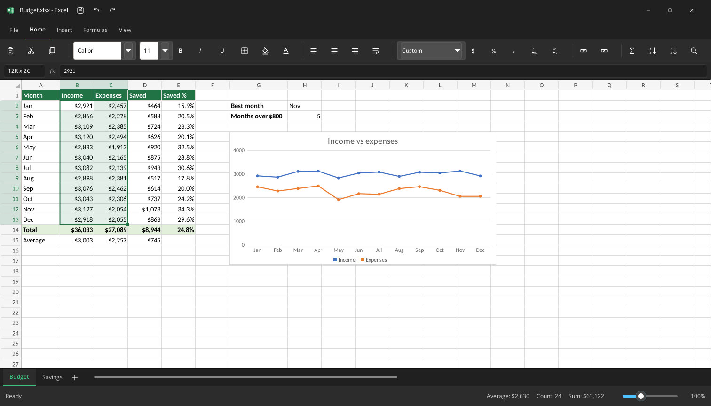
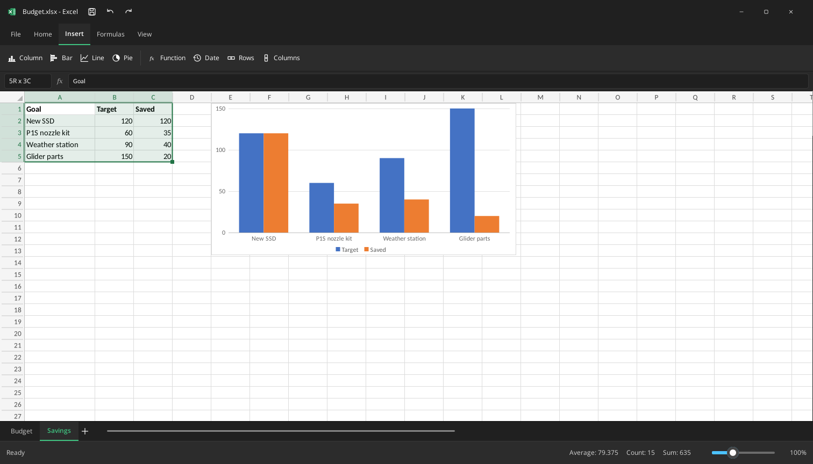

# pi-excel

A Windows 11 style spreadsheet for the Raspberry Pi (built for the Pi 5, works on other Pis running Raspberry Pi OS). It opens and saves real **.xlsx** files (and .csv), which open in Microsoft Office, Google Sheets and LibreOffice. Native GTK app with the Windows 11 dark look, like the other Pi apps.



## Features

- **Formulas** with live recalculation: SUM, AVERAGE, IF, IFS, IFERROR, VLOOKUP, XLOOKUP, INDEX, MATCH, SUMIF(S), COUNTIF(S), TEXT, CONCAT, ROUND, DATE, TODAY, PMT and about 100 more, with references across sheets
- **Click cells while typing a formula** to insert references (they get colored boxes, like Excel)
- **Fill handle**: drag to copy formulas or continue a series (1, 2, 3... or Item 1, Item 2...); Ctrl+D and Ctrl+R
- **Copy and paste** that adjusts formula references, paste values, cut and move
- **Formatting**: fonts, bold/italic/underline, font and fill colors, borders, alignment, wrap text, number formats (currency, percent, date, time, decimals)
- **Insert and delete rows and columns** (formulas update), resize or double-click to autofit, freeze panes
- **Charts**: column, bar, line and pie charts that move, resize and are saved into the .xlsx as real Excel charts
- **Sort** A to Z / Z to A, **AutoSum** (Alt+=), find and replace, Sum/Average/Count of the selection in the status bar
- **Multiple sheets**: add, rename, duplicate, reorder and delete
- **Export as PDF**, show formulas (Ctrl+`), gridlines and headings on or off



## Install

In a terminal on the Pi (as your normal user, not with sudo):

```
git clone https://github.com/wvfouram/pi-excel.git && bash pi-excel/install.sh
```

Then open **Excel** from the menu, or run `pi-excel`.

Becomes the default app for .xlsx and .csv files. Uninstalling puts the previous app back.

To update later:

```
cd ~/pi-excel && git pull && bash install.sh
```

## Keyboard shortcuts

| Keys | Action |
|---|---|
| Ctrl+N / Ctrl+O | New / Open |
| Ctrl+S / Ctrl+Shift+S | Save / Save as |
| Enter / Tab | Confirm and move down / right |
| F2 | Edit the cell |
| Ctrl+Enter | Fill the selection with the entry |
| Alt+Enter | New line in a cell |
| Ctrl+Arrow | Jump to the edge of the data |
| Shift+Arrow | Extend the selection |
| Ctrl+C / X / V | Copy / Cut / Paste |
| Ctrl+D / Ctrl+R | Fill down / right |
| Alt+= | AutoSum |
| Ctrl+; / Ctrl+: | Insert today's date / the time |
| Ctrl+B / I / U | Bold / Italic / Underline |
| Ctrl+F / Ctrl+H | Find / Replace |
| Ctrl+Z / Ctrl+Y | Undo / Redo |
| Ctrl+` | Show formulas |

## Uninstall

```
bash pi-excel/uninstall.sh
```

## License

MIT

This is an independent hobby project. It is not made by, affiliated with or endorsed by Microsoft. Word, Excel and PowerPoint are trademarks of Microsoft.
